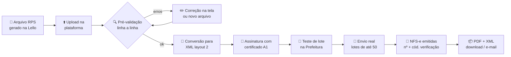

# MayaCorp Automações
## RPA 01 · Emissor Inteligente de NFS-e em Lote — Layout 2 (Reforma Tributária)

> **Documento de Especificação do Projeto** · versão 1.0 · outubro/2026
> Preparado por **MayaCorp** para **CFME Advogados**
> Contato: mayacorp@mayacorp.com.br

---

## Sumário

1. [Resumo executivo](#1-resumo-executivo)
2. [Contexto: por que agora](#2-contexto-por-que-agora)
3. [A plataforma MayaCorp Automações](#3-a-plataforma-mayacorp-automações)
4. [RPA 01: como funciona, de ponta a ponta](#4-rpa-01-como-funciona-de-ponta-a-ponta)
5. [Mapa de telas](#5-mapa-de-telas)
6. [Telas em detalhe](#6-telas-em-detalhe)
7. [Regras de negócio e validações](#7-regras-de-negócio-e-validações)
8. [Integração com a Prefeitura de São Paulo](#8-integração-com-a-prefeitura-de-são-paulo)
9. [Arquitetura técnica](#9-arquitetura-técnica)
10. [Modelo de dados](#10-modelo-de-dados)
11. [API (endpoints)](#11-api-endpoints)
12. [Segurança e LGPD](#12-segurança-e-lgpd)
13. [Infraestrutura 100% online](#13-infraestrutura-100-online)
14. [Identidade visual e experiência](#14-identidade-visual-e-experiência)
15. [Plano de entrega](#15-plano-de-entrega)
16. [Critérios de aceite](#16-critérios-de-aceite)
17. [Roadmap de automações](#17-roadmap-de-automações)
18. [O que precisamos da CFME](#18-o-que-precisamos-da-cfme)
19. [Glossário](#19-glossário)

---

## 1. Resumo executivo

A **MayaCorp Automações** é uma plataforma web, com a marca da CFME, onde ficam reunidos todos os robôs (RPAs) que a MayaCorp desenvolve para o escritório. Cada automação é um módulo: entra no catálogo, ganha suas telas, seus relatórios e seu histórico, sempre no mesmo ambiente, com o mesmo login.

O **primeiro robô** resolve um problema concreto e urgente:

> O sistema da Lello gera um arquivo com vários **RPS** (Recibos Provisórios de Serviço). A plataforma lê esse arquivo, valida cada recibo, converte para o **novo layout 2 da NFS-e de São Paulo** (com os campos de IBS e CBS da Reforma Tributária), assina digitalmente com o certificado da empresa, transmite à Prefeitura e devolve as **notas fiscais emitidas** — PDF e XML — organizadas e prontas para envio.

**Em números:**

| Hoje | Com a plataforma |
|---|---|
| ~500 notas/mês emitidas com processo manual ou dependente do TXT | Upload de um arquivo → notas emitidas em minutos |
| TXT da Prefeitura deixa de aceitar fatos geradores de 2026 | Conversão automática TXT → XML layout 2 via Web Service |
| Erros descobertos só depois do envio | Pré-validação linha a linha **antes** de transmitir |
| Notas espalhadas em pastas e e-mails | Histórico pesquisável, download em lote, auditoria completa |

---

## 2. Contexto: por que agora

A Reforma Tributária do Consumo trouxe dois novos tributos (IBS e CBS) que precisam ser informados na nota fiscal de serviço. A Prefeitura de São Paulo respondeu a isso com duas mudanças que afetam diretamente a CFME:

1. **Fim da emissão por TXT para 2026.** A conversão de RPS em lote no formato texto foi desabilitada para fatos geradores a partir de 1º/01/2026.
2. **Layout 2 só por Online ou Web Service.** O novo layout — que traz ISS, IBS e CBS — está disponível apenas pela emissão no portal ou via Web Service. O layout 1 (antigo, sem IBS/CBS) ainda é aceito, mas a direção é clara: quem não migrar para o layout 2 vai ficar para trás.

**O impacto prático:** o arquivo que a Lello gera continua existindo, mas a Prefeitura não o aceita mais do jeito antigo. Emitir 500 notas manualmente no portal é inviável.

**A solução MayaCorp:** a CFME continua trabalhando exatamente como hoje — exporta o arquivo da Lello — e a plataforma faz a ponte com o mundo novo. Nenhuma mudança de rotina para a equipe; toda a complexidade fica com o robô.

> Base técnica: Manual de Web Service da NFS-e da Prefeitura de São Paulo, versão 3.3.4, e Notas Técnicas SE/CGNFS-e nº 003 e nº 004. Toda alteração futura da Prefeitura é absorvida pela MayaCorp dentro da manutenção mensal.

---

## 3. A plataforma MayaCorp Automações

### 3.1 Conceito

Não é "um sistema de nota fiscal". É um **hub de automações**. O robô de NFS-e é o primeiro morador; os próximos (como o robô de upload de arquivos da Porto Seguro) chegam ao mesmo lugar, sem novo login, sem nova ferramenta para aprender.

```
┌──────────────────────────────────────────────────────────────┐
│  [Logo CFME]  CFME Advogados · Automações        👤 Cristina  │
├────────────┬─────────────────────────────────────────────────┤
│ 🏠 Início   │   Minhas automações                             │
│ ⚡ NFS-e    │   ┌──────────────┐ ┌──────────────┐ ┌─────────┐ │
│ 📤 Porto*   │   │ 🧾 NFS-e      │ │ 📤 Porto      │ │ ＋ Nova  │ │
│ ⚙️ Config.  │   │ 482 notas/mês │ │ Em breve     │ │ ideia?  │ │
│            │   │ ● Ativo       │ │ ○ Planejado   │ │         │ │
│            │   └──────────────┘ └──────────────┘ └─────────┘ │
└────────────┴─────────────────────────────────────────────────┘
                                      * próximo robô no roadmap
```

### 3.2 Princípios do produto

- **Marca do cliente em primeiro plano.** Logo e nome da CFME no topo, na tela de login e nos e-mails. A MayaCorp aparece discretamente no rodapé.
- **Nada acontece sem o usuário ver.** Todo envio passa por uma pré-validação visual; toda ação fica registrada.
- **Zero instalação.** 100% web, funciona em qualquer navegador e no celular.
- **Seguro por padrão.** Certificado digital criptografado, acesso por perfil, trilha de auditoria.
- **Um módulo por automação.** Cada RPA tem seu painel, seu histórico e suas configurações próprias, mas compartilha usuários, identidade visual e cadastros comuns.

### 3.3 Perfis de acesso

| Perfil | Pode |
|---|---|
| **Administrador** | Tudo: configurações, certificado, usuários, emissão, cancelamento |
| **Operador** | Importar arquivos, validar, emitir, baixar notas, cadastrar clientes |
| **Visualizador** | Consultar painel, lotes e notas; baixar PDF/XML |

---

## 4. RPA 01: como funciona, de ponta a ponta



### Passo a passo do usuário

1. **Escolhe a empresa emissora** (se houver mais de uma) e arrasta o arquivo para a tela.
2. **Vê o resumo instantâneo:** quantos RPS, valor total, ISS total, quantos tomadores novos, quantos com problema.
3. **Corrige o que precisar** direto na tabela (ex.: CEP inválido, e-mail faltando) ou descarta linhas.
4. **Clica em "Emitir notas".** A plataforma faz o teste na Prefeitura e, passando, transmite de verdade.
5. **Acompanha ao vivo** a barra de progresso: lote 1/10, 2/10…
6. **Recebe o resultado:** notas emitidas com número e código de verificação; rejeitadas com o motivo traduzido para português claro e botão "corrigir e reenviar".
7. **Baixa tudo em um ZIP** (PDFs + XMLs) ou dispara o envio por e-mail aos tomadores.

### O que o robô faz por trás

- Lê o arquivo (layout TXT de RPS da Prefeitura de SP — registros de cabeçalho, detalhe e rodapé), com detecção automática de encoding.
- Cadastra automaticamente tomadores novos e atualiza os existentes (com confirmação).
- Completa os campos de IBS/CBS que o arquivo da Lello não traz, usando os **parâmetros fiscais padrão** definidos em Configurações.
- Garante que nenhum RPS seja emitido duas vezes (chave única por emissora + série + número de RPS).
- Divide em lotes de até 50 RPS, respeitando o limite da Prefeitura, com fila e novas tentativas automáticas se a Prefeitura estiver instável.

---

## 5. Mapa de telas

```
MayaCorp Automações
├── Login (com a marca da CFME)
├── Início — catálogo "Minhas automações" + visão geral
├── NFS-e (RPA 01)
│   ├── Painel
│   ├── Nova emissão (upload + pré-validação)
│   ├── Lotes
│   │   └── Detalhe do lote
│   ├── Notas emitidas
│   │   └── Detalhe da nota (PDF, XML, cancelar, reenviar e-mail)
│   ├── Empresa Emissora
│   └── Clientes (tomadores)
├── Configurações
│   ├── Identidade (logo, nome, cores)
│   ├── Certificado Digital
│   ├── Usuários
│   ├── Parâmetros Fiscais (padrões ISS / IBS / CBS)
│   └── Notificações e e-mail
└── Auditoria (log de ações)
```

---

## 6. Telas em detalhe

Todas as telas de cadastro seguem o mesmo padrão MayaCorp:
**Cabeçalho da página → Barra de ferramentas (busca + filtros + botão "Novo") → Tabela (hover, badges, ações) → Estado vazio ilustrado → Paginação → Formulário em modal → Confirmação de exclusão → Notificação (toast).**

### 6.1 Login

- Logo e nome do cliente vindos de **Configurações › Identidade**.
- E-mail + senha, "esqueci minha senha" com link por e-mail.
- Bloqueio temporário após 5 tentativas erradas.
- Rodapé: "Uma solução MayaCorp".

### 6.2 Painel da NFS-e

**Cartões de indicadores (mês corrente, com comparação ao mês anterior):**

| Notas emitidas | Valor faturado | ISS | Rejeições | Tempo médio por lote |
|---|---|---|---|---|

**Gráficos:**
- Notas emitidas por dia (linha).
- Top 10 tomadores por valor (barras).
- Status dos últimos lotes (rosca: emitido / parcial / rejeitado).

**Alertas inteligentes no topo:**
- 🟠 "Seu certificado digital vence em 18 dias."
- 🔴 "3 notas do lote #0042 foram rejeitadas — ver motivo."
- 🔵 "A Prefeitura está respondendo lentamente agora; os envios estão na fila."

### 6.3 Nova emissão (o coração do RPA)

**Etapa 1 — Upload**
- Área de arrastar e soltar, aceita `.txt` (layout RPS SP) e, futuramente, `.csv/.xlsx`.
- Seletor de empresa emissora.
- Leitura instantânea no navegador mostra o nome do arquivo, tamanho e quantidade de linhas.

**Etapa 2 — Pré-validação (tabela interativa)**

| ✓ | RPS | Data | Tomador | CPF/CNPJ | Serviço | Valor | ISS | Status |
|---|---|---|---|---|---|---|---|---|
| ☑ | 1021 | 01/11 | Condomínio Ed. Solar | 12.345.678/0001-90 | 01234 | 1.250,00 | 25,00 | 🟢 OK |
| ☑ | 1022 | 01/11 | João da Silva | 123.456.789-00 | 01234 | 800,00 | 16,00 | 🟡 Tomador novo |
| ☐ | 1023 | 01/11 | Cond. Vila Verde | 98.765.432/0001-1? | 01234 | 950,00 | 19,00 | 🔴 CNPJ inválido |

- Filtros rápidos: Todos · OK · Avisos · Erros.
- Clique na linha abre painel lateral para corrigir os dados.
- Resumo fixo no rodapé: **312 RPS · R$ 389.420,00 · ISS R$ 7.788,40 · 3 com erro**.
- Botão **"Emitir 309 notas"** (desabilitado enquanto houver erro marcado para envio).

**Etapa 3 — Transmissão ao vivo**
- Barra de progresso por lote e geral, atualizada em tempo real.
- Pode fechar a tela: o robô continua trabalhando e avisa por e-mail ao terminar.

**Etapa 4 — Resultado**
- Contadores: ✅ emitidas · ❌ rejeitadas.
- Para rejeitadas: código da Prefeitura + explicação em linguagem simples + ação sugerida.
- Botões: **Baixar ZIP (PDF + XML)** · **Enviar por e-mail aos tomadores** · **Exportar planilha de conferência**.

### 6.4 Lotes

Lista de todas as importações: nº do lote, arquivo de origem, emissora, usuário, data, quantidade, valor, status (Validando · Na fila · Transmitindo · Concluído · Parcial · Falhou).

**Detalhe do lote:** linha do tempo do processamento (upload → validação → teste → envio → retorno), arquivo original para download, lista de RPS e respectivas notas, e opção de reprocessar somente os rejeitados.

### 6.5 Notas emitidas

- Busca por número da nota, número do RPS, tomador, CPF/CNPJ, período, valor.
- Colunas: Nº NFS-e, código de verificação, data de emissão, tomador, valor, ISS, status (Emitida · Cancelada).
- Ações por nota: ver PDF, baixar XML, abrir na Prefeitura, reenviar e-mail, **cancelar** (somente Administrador, com confirmação e motivo).
- Ações em massa: baixar selecionadas em ZIP, exportar para Excel.

### 6.6 Empresa Emissora (prestador)

Cadastro de quem emite a nota. Preparado para mais de uma empresa, caso a CFME precise.

| Campo | Observação |
|---|---|
| Razão social / Nome fantasia | |
| CNPJ | validação de dígitos + consulta na Prefeitura |
| Inscrição Municipal (CCM) | obrigatório para SP |
| Endereço completo | CEP com preenchimento automático |
| Regime tributário | Simples Nacional, Lucro Presumido, Lucro Real |
| Código de serviço padrão | item da lista de serviços municipal |
| Alíquota de ISS padrão | |
| Série do RPS | |
| Próximo número de RPS | controle e conferência |
| Certificado vinculado | selecionado em Configurações › Certificado |
| Status | Ativa / Inativa |

Selo de saúde no topo do cadastro: 🟢 "Pronta para emitir" ou 🔴 "Falta certificado válido".

### 6.7 Clientes (tomadores)

Quem recebe a nota. Alimentado automaticamente pelos arquivos importados e editável manualmente.

| Campo | Observação |
|---|---|
| Tipo | Pessoa física / jurídica |
| Nome / Razão social | |
| CPF / CNPJ | validação de dígitos |
| Inscrição Municipal / Estadual | opcionais |
| Endereço completo | CEP com preenchimento automático |
| E-mail(s) para envio da nota | aceita mais de um |
| Telefone | |
| Observações | |
| Histórico | notas emitidas para este cliente, valor acumulado |

Recursos extras: importação/exportação em planilha, mesclagem de duplicados, indicador "dados incompletos".

### 6.8 Configurações

#### 6.8.1 Identidade
- Upload do **logo** (PNG/SVG, com pré-visualização em fundo claro e escuro).
- **Nome do cliente** exibido no sistema, no login e nos e-mails.
- Cor de destaque (opcional), com pré-visualização ao vivo do cabeçalho.
- Assinatura padrão dos e-mails enviados aos tomadores.

#### 6.8.2 Certificado Digital
- Upload do certificado **A1 (.pfx/.p12)** + senha.
- A plataforma lê e exibe: titular, CNPJ, emissor, data de validade, contagem regressiva.
- Botão **"Testar conexão com a Prefeitura"** — faz uma consulta real com o certificado e mostra ✅ ou o erro.
- Alertas automáticos de vencimento por e-mail: 30, 15, 7 e 1 dia antes.
- Histórico de certificados (substituição sem perder o anterior até a troca ser confirmada).
- O arquivo e a senha **nunca** são exibidos novamente nem podem ser baixados.

#### 6.8.3 Usuários
- Lista com nome, e-mail, perfil, último acesso, status.
- Convite por e-mail (o usuário define a própria senha).
- Alterar perfil, desativar, redefinir senha.
- Indicador de quem está online agora.

#### 6.8.4 Parâmetros Fiscais
Valores padrão usados quando o arquivo de RPS não traz a informação — especialmente os campos novos do layout 2:
- Código do serviço e alíquota de ISS.
- Código NBS do serviço.
- Grupo IBS/CBS: CST, classificação tributária e demais indicadores exigidos pelo layout 2, conforme a planilha de campos publicada pela Prefeitura.
- Regras por tomador ou por código de serviço (ex.: "para este código, usar esta classificação").
- Definidos em conjunto com o contador da CFME na implantação.

#### 6.8.5 Notificações e e-mail
- Remetente e servidor de envio (SMTP ou serviço transacional).
- Modelo do e-mail ao tomador (assunto, corpo, anexos PDF/XML), com variáveis: `{nome_tomador}`, `{numero_nota}`, `{valor}`, `{link_prefeitura}`.
- Quem recebe os avisos internos: fim de lote, rejeições, vencimento do certificado.
- Envio automático ao tomador: **ligado / desligado** (decisão da CFME).

### 6.9 Auditoria
Registro imutável de tudo: quem importou, quem emitiu, quem cancelou, quem trocou o certificado, quem alterou um cadastro — com data, hora, IP e o antes/depois do dado.

---

## 7. Regras de negócio e validações

### 7.1 Validações antes do envio
- CPF/CNPJ com dígito verificador.
- Datas: competência válida, sem data futura.
- Valores: positivos, ISS coerente com a alíquota, deduções não maiores que o valor do serviço.
- Código de serviço existente e permitido para a emissora.
- CEP e município válidos.
- Campos obrigatórios do layout 2 preenchidos (do arquivo ou dos parâmetros padrão).
- RPS já emitido anteriormente → bloqueado com link para a nota existente.
- Arquivo de outro CNPJ emissor → alerta e bloqueio.

### 7.2 Regras de emissão
- **Idempotência:** chave única `emissora + série + número RPS`. Reenvios nunca geram nota duplicada.
- **Teste antes do real:** todo lote passa primeiro pelo método de teste da Prefeitura; só segue se estiver limpo.
- **Lotes de até 50 RPS**, enviados em sequência pela fila.
- **Falha de comunicação ≠ rejeição:** timeouts entram em nova tentativa automática (com intervalo crescente); antes de reenviar, o robô consulta se a nota já foi gerada.
- **Rejeição parcial:** o que passou fica emitido; o que falhou fica disponível para correção e reenvio isolado.

### 7.3 Cancelamento
- Somente perfil Administrador.
- Motivo obrigatório; registrado na auditoria.
- Respeita os prazos e regras de cancelamento da Prefeitura; se fora do prazo, a tela explica o caminho.

### 7.4 Mensagens de erro humanizadas
Cada código de retorno da Prefeitura é mapeado para uma frase clara + ação. Exemplo:

| Retorno técnico | O que o usuário vê |
|---|---|
| Erro de assinatura | "O certificado não conseguiu assinar esta nota. Verifique se ele está válido em Configurações › Certificado." |
| Tomador com CNPJ inválido | "O CNPJ do cliente está incorreto. Corrija o cadastro e reenvie." |
| RPS já convertido | "Este recibo já virou nota. Abrir a nota existente →" |

---

## 8. Integração com a Prefeitura de São Paulo

| Item | Definição |
|---|---|
| Canal | Web Service SOAP da Nota Fiscal Paulistana |
| Layout | **Layout 2** (ISS + IBS + CBS) — Manual Web Service v3.3.4 |
| Autenticação | Certificado digital A1 (TLS mútuo) |
| Assinaturas | Assinatura de cada RPS + assinatura XML (XMLDSig) da mensagem, conforme manual |
| Métodos usados | Teste de envio de lote · Envio de lote de RPS · Envio de RPS unitário · Consulta de NFS-e · Consulta de lote · Cancelamento de NFS-e · Consulta de CNPJ |
| Validação | XML validado contra os schemas (XSD) oficiais antes de sair do servidor |
| Limite | Até 50 RPS por lote |
| Ambiente de teste | Serviço de teste de validação do layout 2 disponibilizado pela Prefeitura |

**Camada isolada (`prefeitura_sp`):** toda a comunicação fica num módulo próprio — montagem do XML, assinatura, transporte, interpretação do retorno. Quando a Prefeitura mudar o layout de novo, só esse módulo muda. E ele já nasce pronto para, no futuro, atender a **NFS-e Nacional** ou outros municípios se a CFME precisar.

**Base já testada:** a MayaCorp já implementou emissão de NFS-e via Web Service da Prefeitura de São Paulo em outro sistema jurídico em produção (validação de certificado, emissão real, cancelamento e PDF). Esse conhecimento é reaproveitado aqui, atualizado para o layout 2.

---

## 9. Arquitetura técnica

```
                   ┌──────────────────────────┐
  Navegador ──────▶│  Nginx (HTTPS / SSL)     │
  (desktop/mobile) └────────────┬─────────────┘
                     ┌──────────┴───────────┐
                     ▼                      ▼
          ┌───────────────────┐   ┌───────────────────┐
          │ Frontend Next.js  │   │ API FastAPI        │
          │ (TypeScript)      │──▶│ (Python 3.12)      │
          └───────────────────┘   └─────────┬─────────┘
                                            │
                 ┌──────────────┬───────────┼─────────────┐
                 ▼              ▼           ▼             ▼
          ┌───────────┐  ┌───────────┐ ┌──────────┐ ┌────────────┐
          │PostgreSQL │  │  Redis    │ │ Workers  │ │ Armazenam. │
          │ (dados)   │  │ (fila)    │ │ (robôs)  │ │ PDF/XML    │
          └───────────┘  └───────────┘ └────┬─────┘ └────────────┘
                                            │ SOAP + certificado A1
                                            ▼
                               ┌──────────────────────────┐
                               │ Web Service NFS-e SP     │
                               └──────────────────────────┘
```

| Camada | Tecnologia |
|---|---|
| Frontend | Next.js + TypeScript + Tailwind + shadcn/ui + TanStack Query + Zod + Recharts |
| Backend | FastAPI + SQLAlchemy 2 + Pydantic v2 + Alembic |
| Autenticação | JWT (access + refresh), senhas com hash forte |
| Fila / robôs | Celery + Redis (ou ARQ) — cada lote vira um job; progresso em tempo real via SSE/WebSocket |
| XML / assinatura | `lxml`, `xmlsec`/`signxml`, `cryptography` para leitura do .pfx |
| SOAP | `zeep` ou `httpx` com mTLS |
| PDF da nota | Geração própria (WeasyPrint) com a marca da CFME + link oficial da Prefeitura |
| Banco | PostgreSQL (servidor já existente) |
| Arquivos | Disco do servidor com backup externo; organização por `emissora/ano/mes/` |

**Arquitetura multi-módulo:** o núcleo (`core`: usuários, identidade, auditoria, notificações) é compartilhado; cada RPA vive em seu próprio pacote (`rpa_nfse`, `rpa_porto`…), com seus modelos, rotas, workers e telas. Novo robô = novo pacote plugado, sem mexer no que já funciona.

```
mayacorp-automacoes/
├── backend/
│   ├── app/
│   │   ├── core/            # auth, usuários, identidade, auditoria, e-mail
│   │   ├── modules/
│   │   │   └── rpa_nfse/
│   │   │       ├── models.py
│   │   │       ├── schemas.py
│   │   │       ├── routes.py
│   │   │       ├── parser_txt.py       # leitura do arquivo RPS
│   │   │       ├── validator.py        # pré-validação
│   │   │       ├── prefeitura_sp/      # XML layout 2, assinatura, SOAP
│   │   │       ├── pdf.py
│   │   │       └── tasks.py            # workers da fila
│   │   └── main.py
│   └── alembic/
├── frontend/
│   └── app/(auth)/ (app)/nfse/ (app)/configuracoes/ ...
└── deploy/ (nginx, systemd, scripts)
```

---

## 10. Modelo de dados

```
tenant ──< usuario
tenant ──1 identidade                 (logo, nome, cor, assinatura e-mail)
tenant ──< certificado                (pfx criptografado, validade, titular)
tenant ──< emissora ──1 certificado
tenant ──< tomador
tenant ──< parametro_fiscal           (padrões ISS/IBS/CBS, regras por serviço)
emissora ──< lote ──< rps ──1 nfse
nfse ──< envio_email
tenant ──< auditoria
```

| Tabela | Campos principais |
|---|---|
| `tenant` | id, slug, nome, status, criado_em |
| `usuario` | id, tenant_id, nome, email, senha_hash, perfil, ativo, ultimo_acesso |
| `identidade` | tenant_id, nome_exibicao, logo_path, cor_destaque, assinatura_email |
| `certificado` | id, tenant_id, titular, cnpj, emissor, valido_ate, pfx_cifrado, senha_cifrada, ativo |
| `emissora` | id, tenant_id, razao_social, cnpj, ccm, endereço…, regime, cod_servico_padrao, aliquota_iss, serie_rps, prox_rps, certificado_id |
| `tomador` | id, tenant_id, tipo, nome, cpf_cnpj, im, ie, endereço…, emails[], telefone |
| `parametro_fiscal` | id, tenant_id, emissora_id, escopo (padrão/serviço/tomador), cod_servico, nbs, cst_ibscbs, class_trib, demais campos layout 2 |
| `lote` | id, emissora_id, usuario_id, arquivo_origem, hash_arquivo, qtd, valor_total, status, iniciado_em, concluido_em |
| `rps` | id, lote_id, serie, numero, data, tomador_id, cod_servico, valor, deducoes, iss, dados_json, status, erros_json — **único (emissora, serie, numero)** |
| `nfse` | id, rps_id, numero, cod_verificacao, data_emissao, xml_path, pdf_path, status, cancelada_em, motivo_cancelamento |
| `envio_email` | id, nfse_id, destinatarios, status, enviado_em, erro |
| `auditoria` | id, tenant_id, usuario_id, acao, entidade, entidade_id, antes_json, depois_json, ip, criado_em |

---

## 11. API (endpoints)

```
POST   /auth/login · /auth/refresh · /auth/forgot · /auth/reset

GET    /config/identidade          PUT /config/identidade   POST /config/identidade/logo
GET    /config/certificados        POST /config/certificados   POST /config/certificados/{id}/testar
GET    /config/usuarios            POST /config/usuarios (convite)   PATCH/DELETE /config/usuarios/{id}
GET    /config/parametros-fiscais  POST/PUT/DELETE …
GET    /config/notificacoes        PUT /config/notificacoes

CRUD   /nfse/emissoras
CRUD   /nfse/tomadores             POST /nfse/tomadores/importar   GET /nfse/tomadores/exportar

POST   /nfse/importacoes            (upload → retorna pré-validação)
PATCH  /nfse/importacoes/{id}/rps/{rps_id}   (correção na tela)
POST   /nfse/importacoes/{id}/emitir
GET    /nfse/lotes                  GET /nfse/lotes/{id}   GET /nfse/lotes/{id}/progresso (SSE)
POST   /nfse/lotes/{id}/reprocessar-rejeitados

GET    /nfse/notas                  GET /nfse/notas/{id}
GET    /nfse/notas/{id}/pdf         GET /nfse/notas/{id}/xml
POST   /nfse/notas/zip              POST /nfse/notas/{id}/cancelar   POST /nfse/notas/{id}/enviar-email

GET    /nfse/painel                 GET /auditoria
```

---

## 12. Segurança e LGPD

- **Certificado digital:** arquivo `.pfx` e senha criptografados no banco (Fernet/AES), chave mestra fora do banco, em variável de ambiente do servidor. Descriptografado só em memória, no momento da assinatura.
- **HTTPS obrigatório** em todo o tráfego, com certificado SSL renovado automaticamente.
- **Senhas** com hash forte; política mínima de senha; bloqueio por tentativas.
- **Perfis de acesso** aplicados no backend (não só escondendo botões).
- **Auditoria imutável** de todas as ações sensíveis.
- **Isolamento por cliente (tenant):** cada consulta ao banco é filtrada pelo cliente logado.
- **LGPD:** dados de tomadores usados exclusivamente para a emissão; exportação e exclusão sob solicitação; nenhum dado é compartilhado com terceiros além da Prefeitura.
- **Backup diário** do banco e dos arquivos (PDF/XML), guardado fora do servidor, com retenção definida.
- **Guarda fiscal:** XMLs das notas mantidos pelo prazo legal.

---

## 13. Infraestrutura 100% online

Sem nada rodando em máquina local: desenvolvimento, testes e produção acontecem direto no servidor da MayaCorp na nuvem (Google Cloud), o mesmo que já hospeda outras plataformas da empresa, com PostgreSQL já em operação.

| Ambiente | Endereço (sugestão) | Uso |
|---|---|---|
| **Homologação** | `hml-automacoes.mayacorp.com.br` | Onde tudo é desenvolvido e testado; usa o serviço de teste da Prefeitura (não gera nota real) |
| **Produção** | `automacoes.mayacorp.com.br/cfme` | Ambiente oficial da CFME, emissão real |

- **Banco separado por ambiente:** `automacoes_hml` e `automacoes_prod`.
- **Processos no servidor via systemd:** API, frontend, workers da fila e Redis — reinício automático em caso de falha.
- **Nginx** como porta de entrada, com SSL (Let's Encrypt).
- **Fluxo de atualização:** código editado → enviado ao repositório Git → publicado em homologação → validado com o serviço de teste da Prefeitura → promovido para produção. Nada vai para produção sem passar pela homologação.
- **Monitoramento:** alerta se a fila travar, se a Prefeitura ficar indisponível ou se o servidor tiver problema.
- **Hospedagem, backup e monitoramento** inclusos na manutenção mensal.

---

## 14. Identidade visual e experiência

- **White-label:** o sistema "veste" a marca da CFME (logo, nome, cor de destaque configuráveis).
- **Base de cores MayaCorp** (quando não houver cor do cliente):

| Uso | Cor |
|---|---|
| Primária | Navy `#1E2D6B` |
| Destaque | Indigo `#7C8FFF` |
| Sucesso / emitida | Teal `#1A8F5E` |
| Aviso | Amber `#F5A623` |
| Erro / rejeitada | Red `#C94343` |
| Menu lateral | Dark `#0F1729` |
| Fundo | Gray `#F7F8FC` |

- **Tipografia:** DM Sans (interface) + JetBrains Mono (números de nota, RPS, CNPJ).
- **Modo escuro** automático.
- **Responsivo:** consultar notas e acompanhar lotes pelo celular.
- **Microinterações:** progresso ao vivo, confete discreto ao concluir um lote 100% emitido 🎉, estados vazios ilustrados, atalhos de teclado nas tabelas.
- **Linguagem:** português claro, sem jargão técnico na frente do usuário.

---

## 15. Plano de entrega

| Fase | Entrega | O que a CFME vê funcionando |
|---|---|---|
| **F1 · Fundação** | Servidor, domínios, banco, login, usuários, perfis, identidade visual, auditoria | Acessa o sistema com o logo da CFME e cadastra a equipe |
| **F2 · Cadastros** | Empresa Emissora, Clientes, Certificado Digital (upload + teste de conexão), Parâmetros Fiscais | Certificado validado com ✅ na Prefeitura |
| **F3 · Leitura e pré-validação** | Upload do arquivo da Lello, parser, tabela de validação, correção na tela | Sobe um arquivo real e vê todos os RPS conferidos |
| **F4 · Emissão layout 2** | XML layout 2, assinatura, teste de lote, envio real, fila, retorno, PDF/XML | Primeiras notas reais emitidas pela plataforma |
| **F5 · Pós-emissão** | Notas emitidas, ZIP, e-mail aos tomadores, cancelamento, painel com indicadores | Operação completa do mês |
| **F6 · Operação assistida** | Acompanhamento do primeiro ciclo mensal completo (~500 notas), ajustes finos | Robô rodando no dia a dia |

Cada fase é entregue completa (tela + regra + banco), testada em homologação e só então liberada em produção.

---

## 16. Critérios de aceite

- [ ] Login com a identidade da CFME; perfis Administrador, Operador e Visualizador funcionando.
- [ ] Certificado A1 carregado, validade exibida e teste de conexão aprovado.
- [ ] Arquivo real gerado pela Lello lido sem perda de informação.
- [ ] Pré-validação aponta 100% dos erros de CPF/CNPJ, valores e campos obrigatórios antes do envio.
- [ ] Notas emitidas no **layout 2**, com número e código de verificação gravados.
- [ ] Nenhuma nota duplicada em reenvio ou falha de comunicação.
- [ ] Lote de 500 RPS processado do upload ao resultado sem intervenção manual (salvo correções de dados).
- [ ] PDF e XML de cada nota disponíveis individualmente e em ZIP.
- [ ] Cancelamento funcionando com registro na auditoria.
- [ ] Alertas de vencimento do certificado sendo enviados.
- [ ] Backup diário confirmado.

---

## 17. Roadmap de automações

A plataforma foi desenhada para crescer com a CFME:

| # | Automação | Status |
|---|---|---|
| 01 | **Emissor de NFS-e em Lote (layout 2)** | 🟢 Este projeto |
| 02 | **Robô de upload de arquivos Porto Seguro** | 🔵 Próximo |
| 03 | Envio automático de notas e boletos aos tomadores | 💡 Ideia |
| 04 | Conciliação: notas emitidas × recebimentos | 💡 Ideia |
| 05 | Relatório mensal automático para a contabilidade | 💡 Ideia |
| … | Sua próxima ideia | ➕ |

Cada novo robô entra como um card em "Minhas automações", com login único, mesma identidade visual e mesma central de auditoria.

---

## 18. O que precisamos da CFME

- [ ] **2 ou 3 arquivos reais** de RPS gerados pela Lello (de meses diferentes).
- [ ] **Certificado digital A1** (.pfx) da empresa emissora + senha.
- [ ] CNPJ, Inscrição Municipal (CCM) e regime tributário da emissora.
- [ ] Contato do **contador** para definir os parâmetros fiscais de IBS/CBS.
- [ ] **Logo** em alta resolução (PNG transparente ou SVG) e nome de exibição.
- [ ] Lista de **usuários** (nome, e-mail, perfil).
- [ ] Decisão sobre o **envio das notas**: e-mail automático aos tomadores, download em ZIP, ou ambos.
- [ ] Modelo de texto do e-mail aos tomadores (ou aprovação do nosso modelo).

---

## 19. Glossário

| Termo | Significado |
|---|---|
| **RPS** | Recibo Provisório de Serviços — documento que depois é convertido em NFS-e |
| **NFS-e** | Nota Fiscal de Serviços Eletrônica |
| **Layout 2** | Novo layout da NFS-e de São Paulo, com campos de ISS, IBS e CBS |
| **IBS / CBS** | Imposto e Contribuição sobre Bens e Serviços, criados pela Reforma Tributária |
| **Emissora / Prestador** | Empresa que presta o serviço e emite a nota |
| **Cliente / Tomador** | Quem contrata o serviço e recebe a nota |
| **CCM** | Cadastro de Contribuintes Mobiliários (Inscrição Municipal em SP) |
| **Certificado A1** | Certificado digital em arquivo, usado para assinar e transmitir as notas |
| **Web Service** | Canal de comunicação direta, sistema a sistema, com a Prefeitura |
| **Lote** | Conjunto de até 50 RPS enviados de uma vez à Prefeitura |
| **RPA** | Automação Robótica de Processos — um "robô" que executa tarefas repetitivas |

---

<p align="center"><b>MayaCorp</b> · Fábrica de Software<br/>Prazo definido no orçamento e cumprido.<br/>mayacorp@mayacorp.com.br</p>
